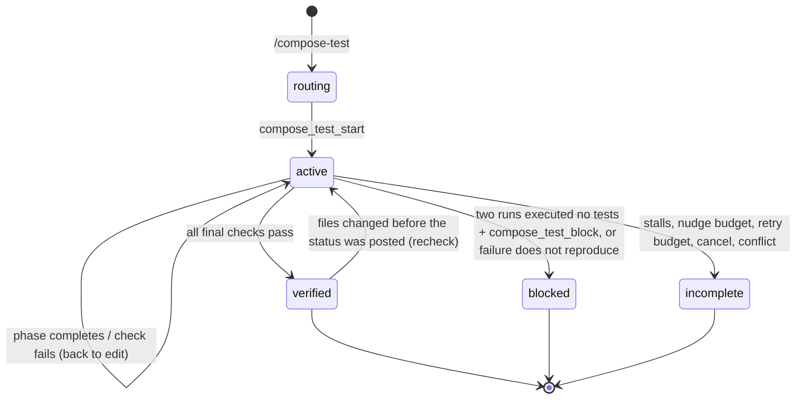

# Architecture

## Components

| File | Owns |
|---|---|
| `src/index.ts` | Pi wiring: `/compose-test`, the `tool_call` edit gate, read tracking, the `agent_before_settle` gate, session restore |
| `src/tools.ts` | The five model-facing tools. Long-running results are committed only if the run did not change meanwhile |
| `src/session.ts` | The run for the current branch. Every change is persisted with `pi.appendEntry` and rebuilt from `getBranch()` |
| `src/workflows.ts` | The workflow registry: phases, edit scopes, allowed final changes, test preservation |
| `src/state.ts` | The `Run` record, pure transitions, and validation of persisted runs |
| `src/engine.ts` | Start validation and phase completion; chains extension-run phases |
| `src/controls.ts` | Negative control (`mutate`) and the fix-failing regression check |
| `src/finalize.ts` | The final checks that decide VERIFIED, and `recheck` at settle |
| `src/runner.ts`, `src/project.ts`, `src/junit.ts` | Gradle invocation, target resolution, JUnit XML parsing |
| `src/tree.ts` | Working-tree fingerprints (git status plus git-hidden source files; full walk without git) |
| `src/baseline.ts` | Start content of files, and the "tests were weakened" check |
| `src/swap.ts` | Crash-safe temporary file replacement that never overwrites someone else's write |
| `src/lint.ts` | Comment- and string-aware Kotlin test rules, each with a citation |
| `src/workspace.ts`, `src/config.ts` | Per-workspace lock and state directory, config loading |
| `skills/compose-robolectric/` | The methodology: core rules plus references loaded per workflow |

## Run lifecycle

## Enforcement points

1. **Before a tool runs** (`tool_call`): `edit`/`write` must target the workspace and a category
   the current phase allows. Nested calls from codemode go through the same hook.
2. **When a phase completes** (`compose_test_step`): the whole tree is diffed against the start
   fingerprint, so changes made through `bash` are caught too. Edit phases also lint changed tests
   and reject weakened tests.
3. **Extension-run phases**: the extension runs Gradle. Verification uses whole classes in
   test-preserving workflows. The negative control and regression check swap files, run the tests,
   and restore them.
4. **Finalize**: allowed changes only, final tree equal to the last passing run's tree, a detected
   control on that same tree, original tests present and passing, no weakened tests, and no lint errors.
5. **Settle** (`agent_before_settle`): a run that is not terminal gets a continuation with its next
   step, bounded by `maxStalls` and `maxNudges`. A VERIFIED run is re-checked against the live tree
   before its status is posted. The status is posted once, including after resume.

## State and recovery

- The run is persisted after every change as a `compose-test-state` custom entry. On
  `session_start` or `session_tree` the extension rebuilds the run from the active branch, so
  `pi -c`, `/resume`, `/fork` and `/tree` continue the right run.
- File swaps record the original bytes first (`swap.json` in the state directory, outside the
  repository). The next session start repairs an interrupted swap. A file someone else changed
  is left alone and its original is saved for comparison.
- A per-workspace lock (`lock.json`) refuses a second session's workflow while a live process holds it.
  The lock is released at terminal status, cancel (after in-flight work), branch changes, and shutdown.

## Context and cost

- The kickoff carries the routing table and the SKILL.md core rules (about 1.5k tokens). References load only when the workflow names them.
- Tool results are short and carry only the next step.
- Test-running phases chain inside one tool call, so verification and the steps after it cost one model turn.
